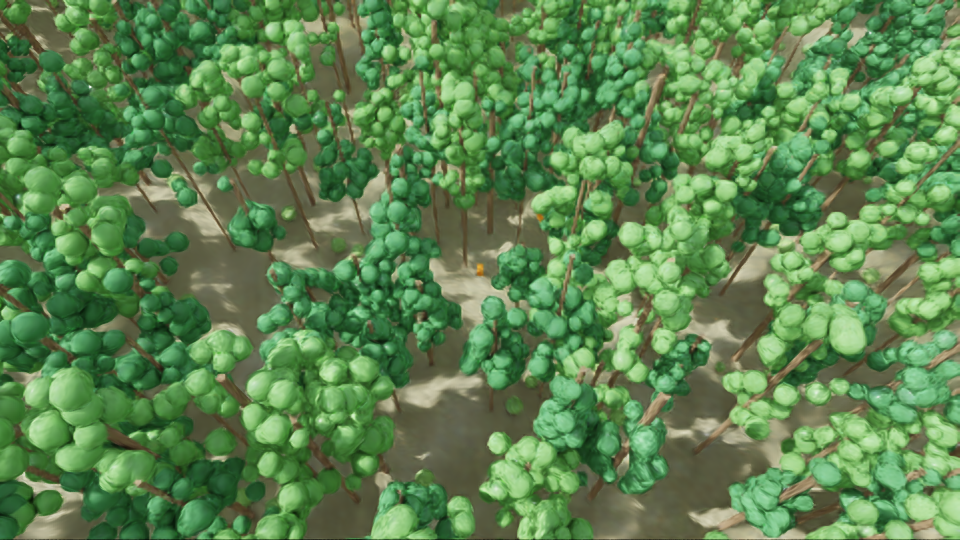
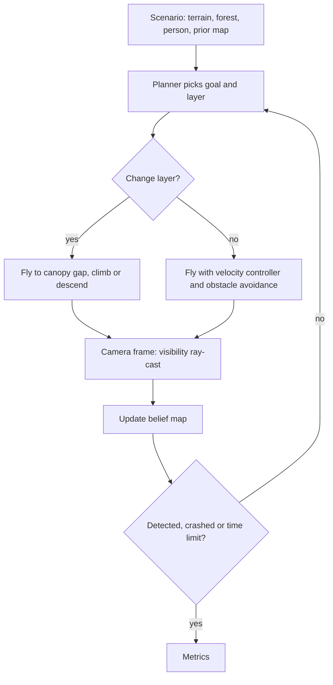
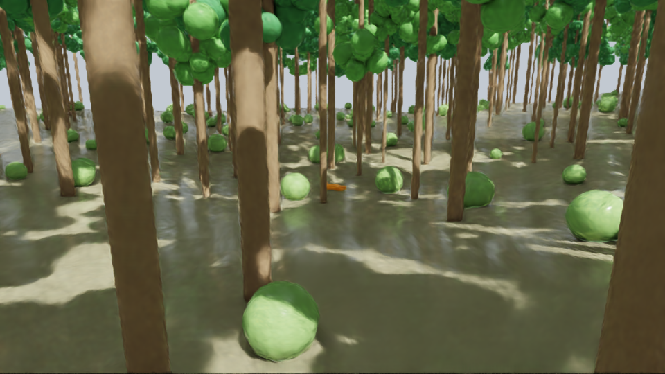

🇬🇧 English · 🇹🇷 [Türkçe](README.tr.md)

# DroneTubitak1002 — Forest SAR Drone Simulator (Phase P0)

**A procedural forest search-and-rescue simulator where a quadrotor looks for a lost person above and between the trees.**

Batched PyTorch simulation (forest, terrain, person, camera, quadrotor dynamics, belief map) with baseline search planners and an Isaac Sim/Lab layer for rendering and visibility validation. Built for a TÜBİTAK 1002 application; only the core (P0) is implemented, other phases are intentionally left as plug-in slots.



*Aerial view of a procedural forest rendered with Isaac Sim (`assets/demo.png`).* <!-- TODO: replace with assets/demo.gif -->

## Summary

| Problem | Method | Simulation / hardware | Paper |
|---|---|---|---|
| Finding a lost person in a forest; canopy occludes the person from above, trees obstruct flight below | Batched mission simulation with a prior map, canopy-gap "descent shafts", and baseline planners (lawnmower, greedy, hybrid) | PyTorch (GPU/CPU) + Isaac Lab (docker) for rendering; no real hardware | TODO: `paper/` (not written yet) |

### System architecture

TODO: add `assets/architecture.png`. Modules in `forestsar/`: terrain, forest, person/world, prior, sensors (camera + depth fan), quadrotor + velocity controller, planners, mission runner, metrics, USD export.

### Flow diagram (how it works)



## Selected results

### Result 1: Rendered view between the trees

Isaac Sim render of the same procedural forest from a between-the-trees pose, showing partial occlusion of the person. The fast ray-cast vs. rendered visibility comparison (`isaac/validate_visibility.py`) is still open (last run reported n = 0), so no quantitative result is claimed yet.



*All figures are in `plots/`.* TODO: planner comparison table/plots from `scripts/run_missions.py`.

## Installation

Requirements: Linux, Python 3.12, PyTorch (CUDA optional). Isaac parts need Docker + NVIDIA GPU (8 GB was not enough for the visibility check).

```bash
git clone https://github.com/GulogluHaktan/DroneSearchandRescue.git
cd DroneSearchandRescue
python -m venv .venv && source .venv/bin/activate
pip install -r requirements.txt
```

## Usage

```bash
python -I scripts/run_missions.py --envs 8 --planners hybrid greedy-above --time-limit 900
```

Expected output: forest statistics line, then one JSON metrics line per planner.

## Reproducing the results

| Figure | Command |
|---|---|
| `plots/sonuc_1.png` (and `runs/isaac_vis/*`) | `scripts/run_isaaclab.sh isaac/validate_visibility.py --enable_cameras --poses 60` |
| Flight recording for video | `python scripts/record_flight.py` then `scripts/run_isaaclab.sh isaac/render_video.py` |

## Project structure

```
DroneTubitak1002/
├── assets/        # README images
├── forestsar/     # main simulator source (PyTorch)
├── isaac/         # Isaac Sim/Lab validation and rendering
├── paper/         # paper (PDF) — TODO
├── plots/         # result figures
├── runs/          # run outputs (large frames/logs are git-ignored)
├── scripts/       # mission runner, recorder, docker launcher
├── tests/
├── requirements.txt
└── README.md
```

## Citation, license, contact

```bibtex
@misc{dronesar2026,
  title  = {Forest SAR Drone Simulator (P0)},
  author = {TODO},
  year   = {2026}
}
```

License: TODO. Contact: TODO.
