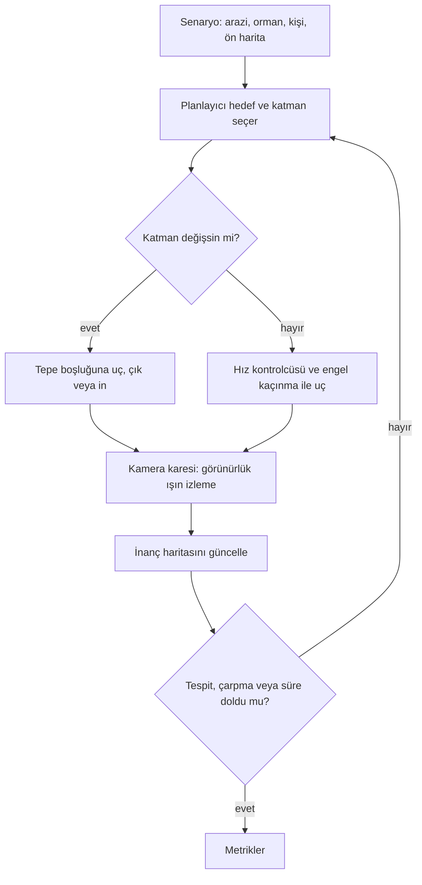

🇬🇧 [English](README.md) · 🇹🇷 Türkçe

# DroneTubitak1002 — Orman Arama-Kurtarma Drone Simülatörü (Faz P0)

**Bir quadrotor'un kayıp bir kişiyi ağaçların üstünden ve arasından aradığı prosedürel orman arama-kurtarma simülatörü.**

Toplu (batched) PyTorch simülasyonu (orman, arazi, kişi, kamera, quadrotor dinamiği, inanç haritası), temel arama planlayıcıları ve render/görünürlük doğrulaması için Isaac Sim/Lab katmanı. TÜBİTAK 1002 başvurusu için hazırlandı; yalnızca çekirdek (P0) uygulandı, diğer fazlar bilinçli olarak eklenti yuvası olarak bırakıldı.


*Prosedürel ormanın Isaac Sim ile render edilmiş havadan görünümü (`assets/demo.png`).* <!-- TODO: assets/demo.gif ile değiştir -->

## Özet

| Problem | Yöntem | Simülasyon / donanım | Makale |
|---|---|---|---|
| Ormanda kayıp kişiyi bulma; tepe örtüsü yukarıdan kişiyi gizler, aşağıda ağaçlar uçuşu engeller | Ön harita, tepe boşluğu "iniş bacaları" ve temel planlayıcılarla (lawnmower, greedy, hybrid) toplu görev simülasyonu | PyTorch (GPU/CPU) + render için Isaac Lab (docker); gerçek donanım yok | TODO: `paper/` (henüz yazılmadı) |

### Sistem mimarisi

TODO: `assets/architecture.png` eklenecek. `forestsar/` modülleri: arazi, orman, kişi/dünya, ön harita, sensörler (kamera + derinlik yelpazesi), quadrotor + hız kontrolcüsü, planlayıcılar, görev yürütücü, metrikler, USD dışa aktarım.

### Akış şeması (nasıl çalışır)



## Seçilmiş sonuçlar

### Sonuç 1: Ağaçlar arasından render görünümü

Aynı prosedürel ormanın ağaç arası bir konumdan Isaac Sim render'ı; kişinin kısmen örtüldüğünü gösterir. Hızlı ışın izleme ile render görünürlük karşılaştırması (`isaac/validate_visibility.py`) hâlâ açık (son çalıştırmada n = 0), bu yüzden henüz nicel bir sonuç iddia edilmiyor.


*Tüm şekiller `plots/` klasöründe.* TODO: `scripts/run_missions.py` ile planlayıcı karşılaştırma tablosu/grafikleri.

## Kurulum

Gereksinimler: Linux, Python 3.12, PyTorch (CUDA isteğe bağlı). Isaac kısımları Docker + NVIDIA GPU ister (görünürlük kontrolü için 8 GB yetmedi).

```bash
git clone https://github.com/GulogluHaktan/DroneSearchandRescue.git
cd DroneSearchandRescue
python -m venv .venv && source .venv/bin/activate
pip install -r requirements.txt
```

## Kullanım

```bash
python -I scripts/run_missions.py --envs 8 --planners hybrid greedy-above --time-limit 900
```

Beklenen çıktı: orman istatistik satırı, ardından her planlayıcı için bir JSON metrik satırı.

## Sonuçları yeniden üret

| Şekil | Komut |
|---|---|
| `plots/sonuc_1.png` (ve `runs/isaac_vis/*`) | `scripts/run_isaaclab.sh isaac/validate_visibility.py --enable_cameras --poses 60` |
| Video için uçuş kaydı | `python scripts/record_flight.py` ardından `scripts/run_isaaclab.sh isaac/render_video.py` |

## Proje yapısı

```
DroneTubitak1002/
├── assets/        # README görselleri
├── forestsar/     # ana simülatör kaynak kodu (PyTorch)
├── isaac/         # Isaac Sim/Lab doğrulama ve render
├── paper/         # makale (PDF) — TODO
├── plots/         # sonuç grafikleri
├── runs/          # çalıştırma çıktıları (büyük kare/log'lar git dışı)
├── scripts/       # görev yürütücü, kaydedici, docker başlatıcı
├── tests/
├── requirements.txt
└── README.md
```

## Atıf, lisans, iletişim

```bibtex
@misc{dronesar2026,
  title  = {Forest SAR Drone Simulator (P0)},
  author = {TODO},
  year   = {2026}
}
```

Lisans: TODO. İletişim: TODO.
